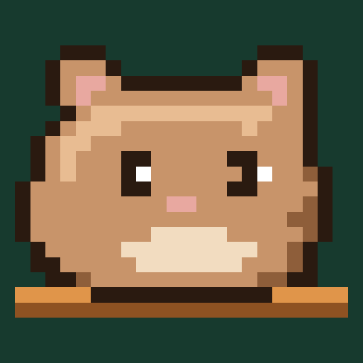
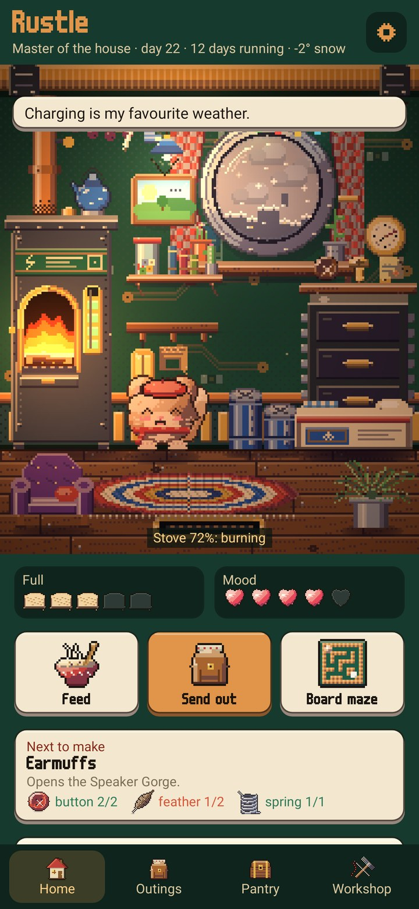
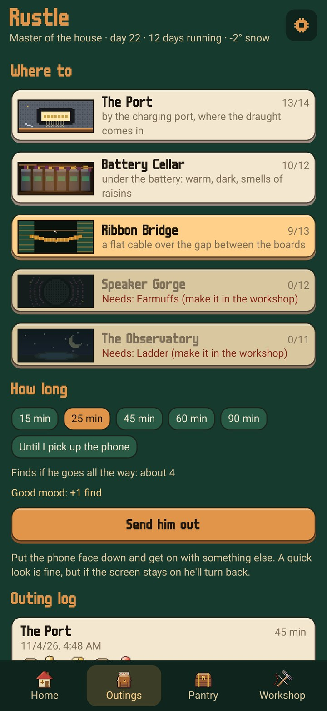
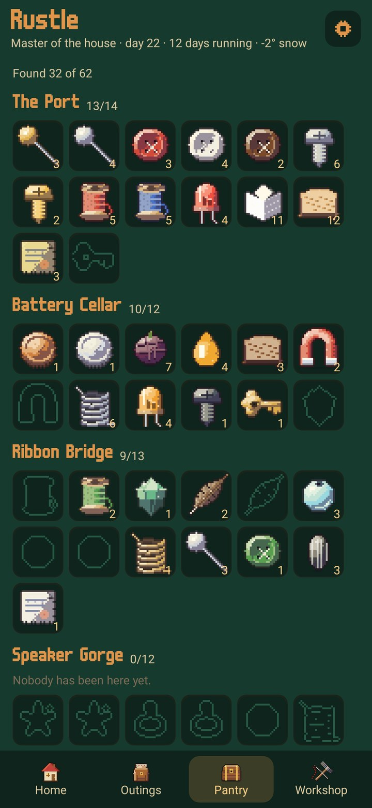
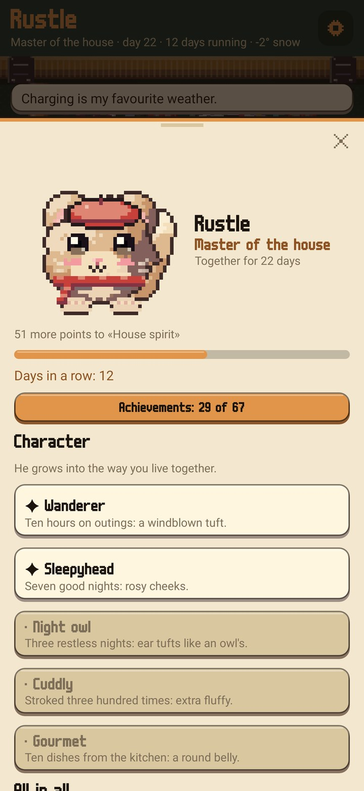

<div align="center">



# Rustle

### A little creature that lives in your phone

*Inside the phone it has a whole little home: the battery is its stove, the camera a round window onto the street, and under the boards there are nooks to explore. It likes it best when you put the phone down: then it goes out and comes back with finds. Free, no ads, no account.*

[](https://github.com/bigdevwhale/rustle/actions/workflows/android.yml)
[](https://github.com/bigdevwhale/rustle/releases/latest)


[](LICENSE)

**English** · [Русский](README.ru.md) · [Changelog](CHANGELOG.md)

   

**[Download the APK](https://github.com/bigdevwhale/rustle/releases/latest/download/Rustle.apk)** · Android 9+

</div>

---

## A home inside the phone

- **The battery is the stove.** While the phone charges, a fire burns and the kettle steams. When the charge runs out, the stove goes cold and Rustle wraps up in a blanket.
- **It feels the phone.** In the dark it lights a candle, in the sun it squints; shake the phone and it gets dizzy, let it overheat and it fans itself. When storage fills up, dust gathers in the corner.
- **The window is the camera.** Behind it are the roofs across the street and the real sky: sunsets by the sun where you are, and, with weather on, clouds, rain, snow, fog and storms.
- **The room fills up.** Everything you make moves in: a matchbox bed, an armchair, a lamp, a clock with a pendulum, a bottle-cap aquarium. Tools hang on the wall.

## Outings

- **Turn the phone face down** and Rustle goes out: to the charging port, the battery cellar, the ribbon-cable bridge, the speaker gorge or the observatory under the camera. New places open with tools from the workshop.
- **The longer the phone lies there,** the further it goes and the more it brings. A quick look is fine; scroll for long and it turns back halfway.
- **The outing shows in a notification,** and on Android 16 as a chip in the status bar.
- **At night it sleeps by the stove.** Put the phone on charge and tuck it in. If the screen stays dark till morning, the night went well and it brings something back from its dreams.

## Finds, the workshop and the kitchen

- **62 finds** from five places: buttons, screws, LEDs, feathers, beads, coins, bits of glass, plus raisins, rusks and honey for food. The rarest, the wonders, turn up on long outings.
- **In the workshop** finds become tools, furniture and clothes. What counts is the shape: any thread will do as thread. Try clothes on right in the workshop: hats, a scarf, a bow tie, glasses, a monocle, a backpack, a cape.
- **In the kitchen** the pantry turns into tea, porridge, a raisin pie and honey cake. A dish fills it up more than its bits on their own.

## Yours

- **Eight kinds:** a rustler, a hedgehog, a lop, a moth, a foxling, an owlet, a kit and a flitter, each with its own ears, tail, wings or spines.
- **Fur:** eight colours, or the colour of any photo: your cat, a favourite jumper, the sea. Patterns: spots, stripes, an eye patch, a mask or socks.
- **Character grows from life.** Ten hours of outings and a tuft sticks up; seven good nights, rosy cheeks; restless nights, owl tufts on the ears.

## Why come back

- **Mood and hunger** change outings: a cheerful Rustle brings one find more, a glum or hungry one, one fewer.
- **Weekly requests.** Every Monday it asks for three things: feathers for a pillow, two walks to the cellar, a good night's sleep. Each one done, it gives you something back.
- **67 achievements,** ranks from tenant to house spirit, and a run of days you looked after it.
- **A board maze:** tilt the phone to roll it to the sugar.
- **A home-screen widget,** dark and light themes, five background colours.

## Privacy

Everything stays on the phone. No account, no ads, no analytics. The internet is used only for the weather in the window, and only if you turn it on: the weather service (Open-Meteo, with MET Norway as a fallback) gets just an approximate location, rounded to about a kilometre.

## Building

```
./gradlew assembleDebug                 # app.rustle.dev
./gradlew assembleDebug -Pdemo          # app.rustle.demo: a lived-in nook three weeks in
./gradlew testDebugUnitTest             # finds, nights, requests, saving
./gradlew testDebugUnitTest -Prender --tests '*RenderArt*'   # scene and creature pictures in app/build/art
```

Kotlin and Jetpack Compose. The creatures, the finds, the icons, the outing places and the nook's walls are drawn with image generation through Codex (`tools/gen.py`) and shrunk into sprites (`tools/cut.py`, `tools/art.py`); the furniture, the fire, the sky in the window and the light are drawn in code.

MIT licence. Fonts: m6x11 by Daniel Linssen; Balsamiq Sans (The Balsamiq Sans Project Authors) and Neucha (Jovanny Lemonad), both under the SIL Open Font License.
