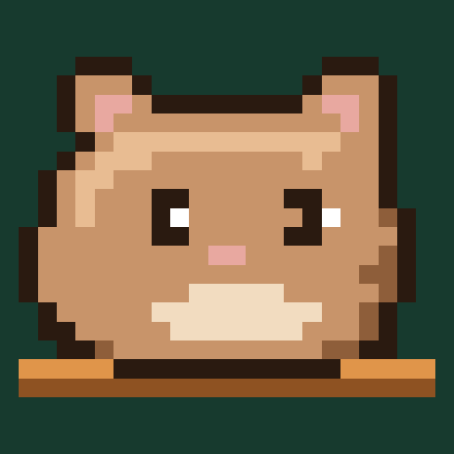
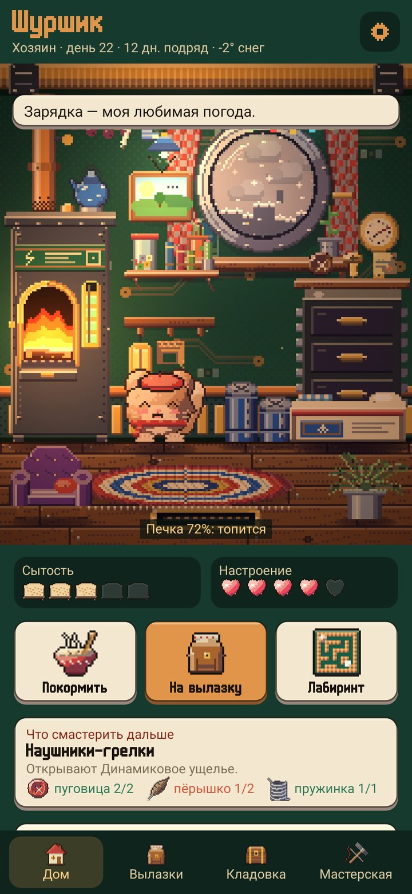
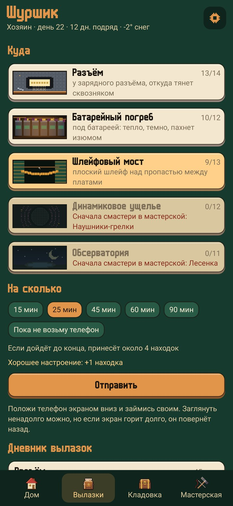
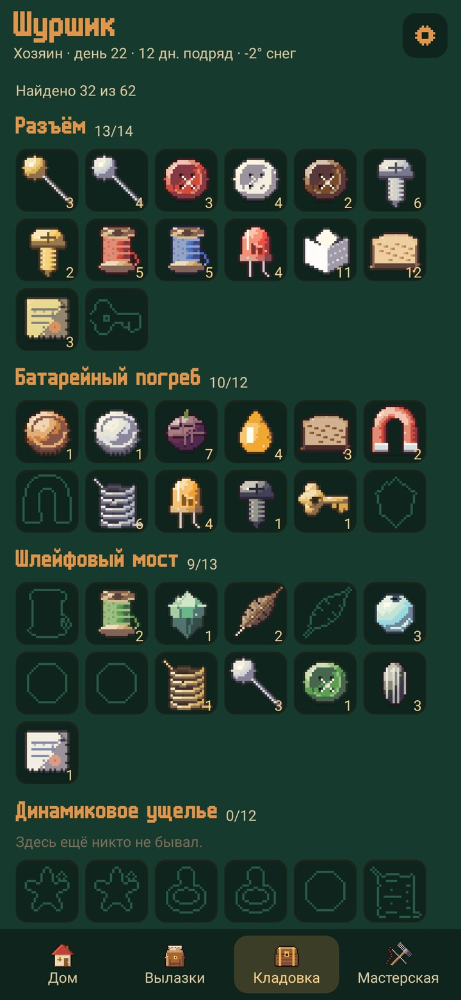
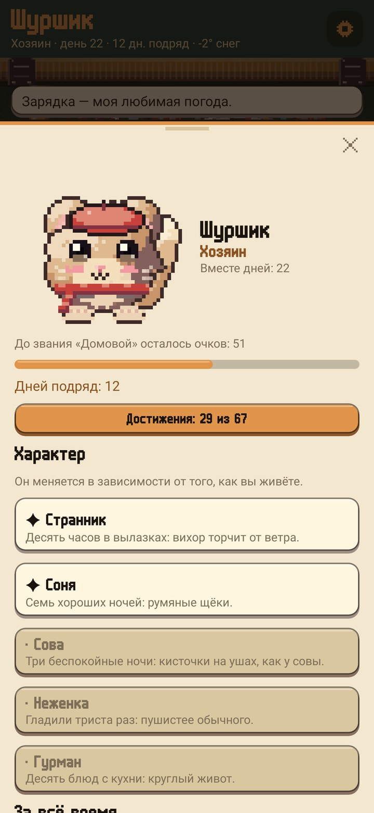

<div align="center">



# Шуршик

### Зверёк, который живёт в телефоне

*У него внутри телефона целый домик: батарея — печка, камера — круглое окно на улицу, а под платами есть закоулки, куда можно сходить. Больше всего он любит, когда вы откладываете телефон: тогда он уходит гулять и возвращается с находками. Бесплатно, без рекламы и аккаунта.*

[](https://github.com/bigdevwhale/rustle/actions/workflows/android.yml)
[](https://github.com/bigdevwhale/rustle/releases/latest)


[](LICENSE)

[English](README.md) · **Русский** · [Изменения](CHANGELOG.md)

   

**[Скачать APK](https://github.com/bigdevwhale/rustle/releases/latest/download/Rustle.apk)** · Android 9+

</div>

---

## Домик внутри телефона

- **Печка — это батарея.** Пока телефон заряжается, в печке горит огонь и на ней пыхтит чайник. Когда заряд кончается, печка остывает, и Шуршик кутается в плед.
- **Он чувствует телефон.** В темноте зажигает свечку, на солнце жмурится, если трясти — у него кружится голова, когда телефон перегрелся — обмахивается. А если память забита, в углу заводится пыль.
- **Окно — это камера.** За ним крыши соседних домов и настоящее небо: закаты по солнцу там, где вы, а если включить погоду — облака, дождь, снег, туман и гроза.
- **Комната обживается.** Всё, что вы смастерите, встаёт в домик: кровать из спичечного коробка, кресло, лампа, часы с маятником, аквариум в пробке. Инструменты висят на стене.

## Вылазки

- **Переверните телефон экраном вниз,** и Шуршик уйдёт гулять: к разъёму, в батарейный погреб, по шлейфовому мосту, в динамиковое ущелье или в обсерваторию под камерой. Новые места открываются инструментами из мастерской.
- **Чем дольше телефон лежит,** тем дальше он заходит и тем больше приносит. Заглянуть в телефон ненадолго можно, но если надолго залипнуть в экран, он вернётся с полпути.
- **Ход вылазки виден в уведомлении,** а на Android 16 — значком в строке состояния.
- **Ночью он спит у печки.** Поставьте телефон на зарядку и уложите его. Если до утра экран почти не загорался, ночь удалась, и утром он отдаст что-нибудь из сна.

## Находки, мастерская и кухня

- **62 находки** из пяти мест: пуговицы, винтики, светодиоды, пёрышки, бусины, монетки, стёклышки, а ещё изюм, сухари и мёд — это еда. Самые редкие, диковины, попадаются на долгих вылазках.
- **В мастерской** из находок собирают инструменты, мебель и одёжку. Важна форма вещи: любая нитка сойдёт за нитку. Одёжку можно примерить прямо в мастерской: шапки, шарф, бабочку, очки, монокль, рюкзак, плащ.
- **На кухне** из запасов готовят чай, кашу, пирожок и медовик. Блюдо сытнее, чем продукты по отдельности.

## Он у вас свой

- **Восемь видов:** Шуршик, ёжик, ушастик, мотылёк, лисёнок, совёнок, котик и нетопырь. У каждого свои уши, хвост, крылья или иголки.
- **Окрас** — восемь цветов или цвет с любой фотографии: своего кота, любимого свитера, моря. Узор: пятнышки, полоски, пятно у глаза, маска или носочки.
- **Характер вырастает из жизни.** Десять часов в пути, и у него торчит вихор. Семь хороших ночей — румяные щёки. Беспокойные ночи — кисточки на ушах, как у совы.

## Зачем возвращаться

- **Настроение и сытость** влияют на вылазки: весёлый Шуршик приносит на одну находку больше, а грустный или голодный — на одну меньше.
- **Просьбы на неделю.** Каждый понедельник он просит о трёх вещах: принести пёрышки на подушку, дважды сходить в погреб, хорошо выспаться. За каждую дарит что-нибудь в ответ.
- **67 достижений,** звания от квартиранта до домового и серия дней, когда вы о нём заботились.
- **Лабиринт на плате:** наклоняйте телефон и докатите его до сахара.
- **Виджет** на рабочий стол, тёмная и светлая темы, пять цветов фона.

## Конфиденциальность

Всё хранится только на телефоне. Без аккаунта, рекламы и аналитики. Интернет нужен только для погоды за окном, и то если её включить: в сервис погоды (Open-Meteo, запасной — MET Norway) уходит лишь приблизительное место, округлённое примерно до километра.

## Сборка

```
./gradlew assembleDebug                 # app.rustle.dev
./gradlew assembleDebug -Pdemo          # app.rustle.demo: три недели обжитого домика
./gradlew testDebugUnitTest             # находки, ночи, просьбы, сохранение
./gradlew testDebugUnitTest -Prender --tests '*RenderArt*'   # картинки сцены и персонажей в app/build/art
```

Kotlin и Jetpack Compose. Вся пиксельная графика — домик, существа, находки, иконки — рисуется прямо в коде, без готовых картинок.

Лицензия MIT. Шрифт m6x11 Даниэля Линссена.
